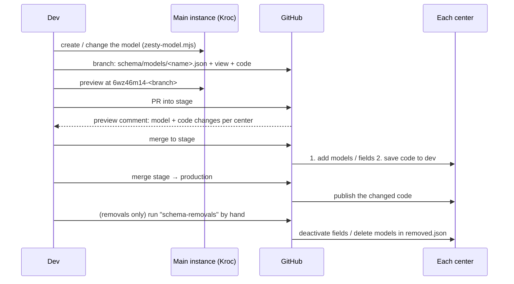

# Center sync — one template repo, many center instances

This is Path A from the 11-12 architecture call
(`KROC-draft/meetings/11-12 gh architecture discussion/scaling-options.md`, §3 and §12).
**Kroc** (`8-80c0bba6b8-lhkcc7`) is the **main** instance, where models are
designed. Every instance listed in [`centers.json`](../centers.json) receives
the same **models** and **code** from this repo. Content (pages, block
variants, globals, `z/pvl` layouts) is **not** synced: every center keeps its
own.

Status: tested end to end against one test center, KROC National
(`8-cec38bc5e1-nkc8tg`), on 2026-11-13. `tools/center-sync/e2e.mjs` passes
53/53 checks (§6).

## 1. What lives where

| | Source of truth | Reaches centers through |
| --- | --- | --- |
| Models + fields | `schema/models/<name>.json` (exported from main) | the model step at the **stage** merge (additive only) |
| Removed models / fields | `schema/removed.json` | the **manual** `schema-removals` run, after production |
| Code (`webengine/views`, `styles/main.less`, `scripts/main.js`) | `webengine/` | saved to dev at the **stage** merge, published at the **production** merge |
| Which centers, what not to sync | `centers.json` (`schemaExclude`, `codeExclude`) | — |

Everything is matched **by name**: model name, field name, related model and
field, a parent page by its model, and a view by its file name. ZUIDs differ
on every instance, so none are stored. (`zesty.config.json` is Kroc's own
file-to-ZUID map and is gitignored; the sync doesn't use it.)

Never synced (`codeExclude`):
- `views/z/**`: page layouts named after Kroc's own page items
- `views/tractionrec/**`: written per center by the TractionRec sync
- `views/_runner/**`, `test_page`, `custom-endpoints/test.json`: scratch
- `desktop_design.html`, `mobile_design.html`: prototype references
- `styles/tailwind.css`: build output, already inlined into `components/styles.html`

The `test_page` model is left out of `schema/` as well, because its
integration field once held a Salesforce token. The export refuses any model
that looks like it contains a credential, because this repo is public.

## 2. The flow



**Branch previews:** `<center-hash>-<branch>.webengine.zesty.io` works on any
center that has the models and is linked to this repo (developer settings
`gh_username = TSAUSN`, `gh_repository = Kroc-Center-Template`). A branch that
**adds** a model previews only on the main instance until it's merged to stage.

## 3. Day to day

**New or changed model**
1. Make the change on the main instance with the `zesty` skill's
   `zesty-model.mjs` (`create`, `add-fields`, `update-field`).
2. Export **only that model**: `node tools/center-sync/cli.mjs export <model>`.
   Exporting everything would also pick up other branches' unfinished fields,
   because models aren't branched.
3. Commit the schema file together with the code that uses it.

**Code only:** commit as usual. The PR preview lists what each center will get.

**Removing a field or model:** do it in this order. The live sites must not
lose something the live code still reads.
1. Remove its use from the code, and remove it from the main instance and from
   `schema/` (delete the file for a model, the field entry for a field).
2. List it in `schema/removed.json` in the same PR. The preview shows it as
   "waiting for the manual run".
3. Merge to stage, then to production.
4. Run the **Center sync** workflow by hand with task `schema-removals`. Run it
   with *dry run* first, then for real.
5. Clear the entry from `removed.json`.

A deleted plain file (component, endpoint) is removed from every center by the
production merge. A deleted model view goes when its model is removed.

## 4. What the model step will and won't do

| Change | At the stage merge | Otherwise |
| --- | --- | --- |
| New model (incl. relations to models created in the same merge), new field | applied | — |
| Label, description, required, options, settings, repeater sub-fields, relation target or display field, sort, parent page/model | applied | — |
| Dropped dropdown option | applied, flagged in the preview | — |
| Model `listed` flag | reported under "Needs a person" | the API can't change it: set it in the Manager |
| Field or model gone from `schema/` | reported as waiting | `removed.json` + manual run |
| A field re-added with the same name and type | the center's deactivated field is **restored** (its old values come back) | — |
| Datatype or model-type change, a center-only field or model | reported under "Needs a person" | change by hand, or `--prune` (below) |

`--prune` (CLI only) makes one center match `schema/` exactly. It deletes
fields and models the schema doesn't have, and recreates type conflicts. Use it
for onboarding a center, never as a routine step.

### Content and block variants

**Variants are content, so they are never copied.** That goes for block
variants, page items and dataset rows alike. Main's variants stay on main, and
each center makes its own. What the sync does instead is protect what a center
already has:

- **The preview shows each change's effect on the center's items** (ℹ / ⛔):
  - "2 existing item(s) start with it empty" for a new field
  - "1 item(s) hold a dropped option"
  - "1 item(s) are empty and can't be saved until filled" for a newly required field
  - "1 item(s) link to X items, which won't match Y" for a retargeted relation
  - "N item(s) hold a value here" for a removed or retyped field
- **Deleting a model that has items, or hard-deleting a field that holds
  values, is refused** unless the run is given `--allow-content-loss` (an input
  of the manual workflow, off by default). A removal through `removed.json`
  only **deactivates** a field, so its values are hidden and come back if the
  field is re-added.
- **A model can't be removed while another model's relation still points at
  it.** Remove the relation field in the same `removed.json` change.
- New fields arrive empty on existing variants. Templates must read them
  presence-driven (`{{if {this.field} }}`). An unguarded read of a new empty
  text field or repeater still rendered fine on a block variant in the test.

## 5. Commands

```bash
# main instance → schema/   (token: $ZESTY_TOKEN_MAIN or .vscode/settings.json)
node tools/center-sync/cli.mjs export [model…]

# what CI runs (center tokens: env vars named by each center's tokenEnv)
node tools/center-sync/cli.mjs deploy --branch stage|production [--center id] [--since <sha> | --full] [--dry-run] [--report out.md]

# by hand
node tools/center-sync/cli.mjs schema [--center id] [--model a,b] [--removals] [--prune] [--allow-content-loss] [--dry-run]

# end-to-end test (temporary zz_e2e_* models on main + the center; ~3–6 min; cleans up)
node tools/center-sync/e2e.mjs [--center national] [--verbose] [--keep]
```

The e2e test acts as both the developer (changing models on main) and the
center editors (creating variants and dataset rows on the center). It checks:
- **S1:** create, including relations to a same-run model and to an existing
  model, repeaters, options, and a nested pageset
- **S2:** center-owned content
- **S3:** relabels, reorders, a new field and option, sub-fields, the relation
  display field, a parent move, and old variants rendering with new fields
- **S4:** a dropped option, a newly required field, and a retargeted relation,
  all flagged with their impact
- **S5:** a datatype change is reported, prune refuses to destroy data, then
  `--allow-content-loss`
- **S6:** a soft field removal
- **S7:** re-adding a field restores its values
- **S8:** a relation target can't be removed alone
- **S9:** models with center content aren't deleted without the flag

Workflows: `.github/workflows/center-sync-preview.yml` posts the preview
comment on PRs into stage/production. `.github/workflows/center-sync.yml` runs
on stage/production pushes and by hand (`schema-one-center`,
`schema-removals`, `stage-full`, `production-full`; dry run is on by default).

## 6. Adding a center

1. Add it to `centers.json` with a `tokenEnv` name, and add a repo secret of
   that name holding the instance's developer token.
2. `schema --center <id> --prune --dry-run`, read the output, then run it
   without `--dry-run`. If it refuses because the center's own content would
   be lost, decide what happens to that content first. Only then add
   `--allow-content-loss`.
3. Run the `stage-full` task (dry run first), then `production-full`.
4. Link the instance to this repo in its developer settings
   (`gh_username`, `gh_repository`).
5. Fill its content, starting with **Globals**: see the findings below.

## 7. Findings from the test (2026-11-13)

- **Creating a view through the API publishes it immediately.** A new file
  would go live at the stage merge. The sync creates it blank and then saves
  the real code as v2, so live stays blank until production publishes v2.
- **A single-page model created through the API gets no page item.** The
  Manager creates one, the API doesn't (`blocks_catalog_page`,
  `categories_page` on National have none). That page doesn't exist on the
  center until someone creates it, and nothing can be nested under it.
- **Empty Globals break the preview.** On a fresh center, `{{ globals.social_handles }}`
  in `components/shared.jsx` errors with "field doesn't exist on the globals
  content model" while the repeater is empty. Preview renders show the error
  and live renders hide it. Fill Globals, or make the read empty-safe. This is
  specific to `globals.*`: the same raw read on a block variant renders fine
  (e2e S3).
- **A model's `listed` flag can't be changed through the API.** `PUT
  content/models/<6>` updates the label and description but silently keeps
  `listed` (and rejects 0/1). It's set at creation only; afterwards the sync
  reports the difference for someone to change in the Manager.
- **Restoring a deactivated field brings its values back** (e2e S7). So a
  removal through `removed.json` can be undone by re-adding the field.
- **WebEngine caches renders.** Right after a sync the dev preview can serve
  the old template for a few minutes.
- **Kroc-only IDs in code:** `loader` lists the Blocks Catalog item ZUID, but
  also matches by path, so it still works on centers. The four unbuilt block
  placeholders (`custom_forms`, `custom_navigation`, `external_embed`,
  `featured_classes`) link to Kroc's Manager. The sync never copies a
  placeholder, so each center keeps its own.
- **The skill's auto-push hook** still writes edits straight to Kroc's dev
  version. In this flow Kroc is the main instance, so that's fine for Kroc,
  but centers only change through GitHub.
