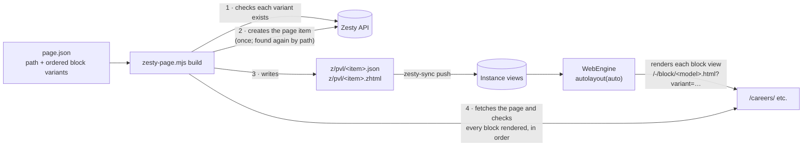

# Building Freestyle pages from code

The KROC informational pages (Rentals, Careers, App & Portal, …) are **Freestyle** pages: an ordered stack of block variants, which editors normally drag into place in the Manager's Layout tab. This guide shows how to build the same page from code, so a page can be assembled from the variants the moment its blocks exist. It covers how Freestyle stores a page, the `zesty-page.mjs` tool, the page spec format, what the tool checks, and the traps found so far.

Pages built so far, with every design section and anything missing, are recorded in [`../KROC-draft/page-builds.md`](../../KROC-draft/page-builds.md).

| Page | Path | Sections placed | Missing (block not built) |
|---|---|---|---|
| 6.18 Rentals | `/rentals/` | 7 of 9 | section tabs (2447), interest form (`custom_forms`) |
| 6.20 Careers | `/careers/` | 9 of 10 | duplicate "Join our Team!" intro, left out on purpose |
| 6.23 App & Portal | `/app-and-portal/` | 8 of 8 | none (placeholder images and PDFs) |
| 6.16 Day Pass | `/day-pass/` | 4 of 4 | none |
| 6.22 Hours of Operation | `/hours/` | 7 of 8 | Activity Schedules (`external_embed`; calendar source undecided) |
| 6.19 Kroc Church | `/church/` | 9 of 9 | none (Welcome sits in a `rich_text` card) |
| 6.17 About Us | `/about-us/` | 8 of 8 | none |
| 6.21 Donate Hub | `/give/` | 5 of 6 | campaign grid (`[donation_campaigns]`) |
| 6.15 Membership | `/membership/` | 9 of 10 | hold/cancel form (`custom_forms`) |

## How Freestyle stores a page

A Freestyle page is **a page item plus two view files named after it**. They live in `webengine/views/z/pvl/` and sync like any other view.

| File | Holds | Read by |
|---|---|---|
| `z/pvl/<7-item-zuid>.json` | The layout tree: `layout:root:column:0` → `children`, one entry per block (`content:block:<6-model-zuid>:<position>:<n>`), each with the block call, the model, its position and its name | The Manager's Layout editor |
| `z/pvl/<7-item-zuid>.zhtml` | The same layout as markup: a root `<div>` with one `{{block('/-/block/<model>.html?variant=<7-zuid>')}}` per block, in order | WebEngine, when it renders the page |

`z/layouts/layouts.json` holds the Manager's row and column presets. Every KROC page so far is a single root column, because each block draws its own grid.

The page model's view renders the layout with **`{{ this.autolayout(auto) }}`**. A bare `{{ this.autolayout() }}` ignores the layout and prints the item's raw fields. `informational_pages` used the bare form until 2026-11-09.



## Building a page

Run from the Kroc-Center-Template root:

```bash
node .claude/skills/zesty/scripts/zesty-page.mjs build page.json --dry-run   # print the plan
node .claude/skills/zesty/scripts/zesty-page.mjs build page.json             # build it
node .claude/skills/zesty/scripts/zesty-page.mjs show careers                # list a page's layout
```

`page.json` (Careers, as built):

```json
{
  "model": "informational_pages",
  "path": "careers",
  "name": "Careers",
  "data": { "page_name": "Careers", "page_content": "<p>…</p>" },
  "blocks": [
    ["hero", "Careers Hero"],
    ["card_grid", "Careers Values"],
    ["careers_benefits", "Careers Benefits"],
    ["intro_band", "Careers Open Positions"],
    ["careers_jobs", "Careers Job Listings"],
    ["careers_apply", "Careers How to Apply"],
    ["intro_band", "Careers Join Us"],
    ["people", "Careers HR Contacts"],
    ["rich_text", "Careers Territorial Information"]
  ]
}
```

| Key | Meaning |
|---|---|
| `model` | The page model. KROC informational pages use `informational_pages`. |
| `path` | The URL path part (`careers` → `/careers/`). This is also how an existing page is found again. |
| `name` | The page's meta title and link text. Used only when the page is created. |
| `data` | The page item's own fields: the model's required ones (`page_name`, `page_content`). Used only when the page is created. |
| `blocks` | The page, top to bottom. Each entry is `[block model, variant name or 7-… ZUID]`. |

### What `build` does

1. **Checks every block** before writing anything: the model must be a block model, and the variant must exist on it (by name or ZUID).
2. **Finds or creates the page item.**
   - It looks for an item of the model with that path.
   - If there's none, it first confirms nothing else answers at that path on dev, then creates the item, listed at the site root.
   - An existing item's fields are never changed.
3. **Writes both layout files** in the Manager's format and pushes them. The layout is rewritten whole on every build, so re-running with a changed `blocks` list reorders, adds or drops blocks.
4. **Fetches the page** and checks that every block's section (`kroc-<block>-<variant zuid>`) rendered, in order, inside the Freestyle container.

It also warns when the page model's view doesn't call `autolayout(auto)`, and it never deletes anything.

### Before a build

- **Every block needs a variant with the page's content.** Create missing ones with `zesty-variant.mjs create` (Careers needed a new "Careers Hero"; Rentals needed its Theatre, Rates & Specs and Corner Zone variants).
- **List every design section in `KROC-draft/page-builds.md`:** what was placed and what is missing, with the reason.

## Traps found so far

- **One missing variant takes the whole page down.** A block call to a deleted variant returns HTTP 400 for the entire page, not just that block. The homepage was failing for this reason on 2026-11-09: its layout still calls the deleted Family Play "(copy)" variant `7-dce2dae3a3-j1khws`. When a variant is deleted, remove it from every `z/pvl/*.zhtml` and `.json`.
- **Required photo fields need something.** `facility_section` requires a photo, so the Rentals facility cards use the media library's stock images as stand-ins until real photos are uploaded.
- **API-made pages are unversioned.** A page item made through the API has no saved version until someone saves it in the Manager. Dev renders it anyway; the live domain needs a publish.
- **Check the path in the design notes first.** Donate Hub was built at `/donate/` and had to be moved to the design's `/give/`. Each `PageFrame`'s `notes` in the prototype names the path.
- **`featured_pages` turns `block_name` into a heading.** The field is required, so a chip row the design shows without a heading still gets one.
- **Not yet confirmed:** that the Manager's Layout editor opens a code-written `.json` cleanly and shows its blocks. Open the page's Layout tab once to check before editing there.

## Where else this is documented

- [`.claude/skills/zesty/reference/freestyle-pages.md`](../.claude/skills/zesty/reference/freestyle-pages.md): the same method, for the Claude Code skill, including the manual API steps.
- [`AGENTS.md`](../AGENTS.md) §5: the `z/pvl/` folder, the tool, and the pages built.
- [`../KROC-draft/page-builds.md`](../../KROC-draft/page-builds.md): per page, every design section, placed or missing.
